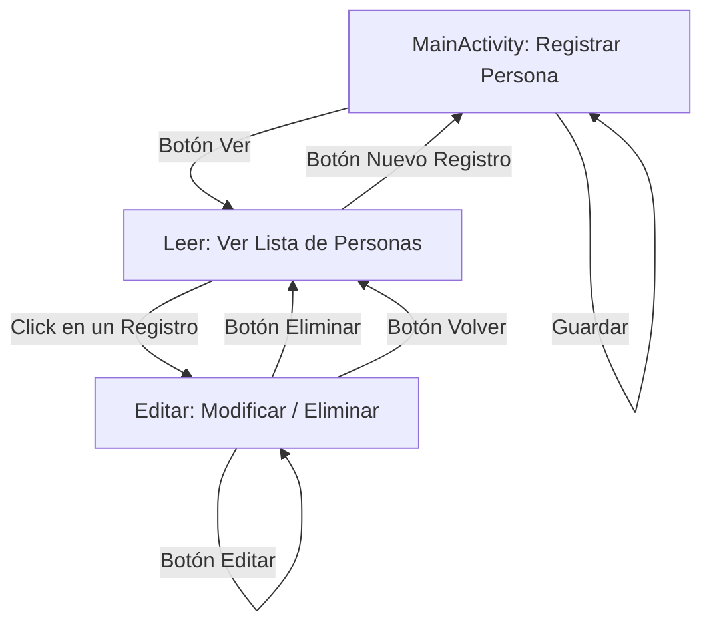

# Proyecto Android: Gestión de Registros con SQLite

Este proyecto es una aplicación nativa de Android desarrollada en **Java** que demuestra cómo realizar operaciones **CRUD** (Crear, Leer, Actualizar, Eliminar / *Create, Read, Update, Delete*) utilizando una base de datos local **SQLite** mediante la clase nativa `SQLiteOpenHelper`.

---

## 🚀 Características Principales

- **Crear Registros (Create):** Permite registrar personas indicando su *Nombre*, *Apellido* y *Edad*.
- **Consultar Registros (Read):** Muestra un listado dinámico (`ListView`) con todos los registros almacenados en la base de datos local.
- **Actualizar Registros (Update):** Permite modificar los datos de cualquier registro seleccionado.
- **Eliminar Registros (Delete):** Permite borrar registros de la base de datos a través de su ID único.
- **Consultas Seguras:** Implementación de sentencias SQL parametrizadas (`execSQL` con argumentos y `SQLiteStatement`) para prevenir vulnerabilidades de inyección SQL.

---

## 📁 Estructura del Código Fuente

La lógica principal se encuentra ubicada en el paquete `com.example.sqlite`:

```text
app/src/main/java/com/example/sqlite/
├── DBHelper.java     # Gestor de la Base de Datos SQLite (Creación y estructura)
├── Persona.java      # Modelo / Entidad de datos
├── MainActivity.java # Pantalla de registro de datos (Create)
├── Leer.java         # Pantalla de visualización de registros en lista (Read)
└── Editar.java       # Pantalla de modificación y eliminación de registros (Update & Delete)
```

---

## 🗄️ Esquema de la Base de Datos (`BD_EJEMPLO.db`)

La base de datos se gestiona a través de la clase `DBHelper`.

### Tabla: `persona`

| Columna   | Tipo de Dato | Restricciones                      | Descripción                          |
| --------- | ------------ | ---------------------------------- | ------------------------------------ |
| `id`      | `INTEGER`    | `PRIMARY KEY AUTOINCREMENT`        | Identificador único de la persona.   |
| `nombre`  | `TEXT`       | `NOT NULL`                         | Nombre de la persona.                |
| `apellido`| `TEXT`       | `NOT NULL`                         | Apellido de la persona.              |
| `edad`    | `INTEGER`    | `NOT NULL`                         | Edad de la persona.                  |

---

## 🧩 Descripción Detallada de las Clases

### 1. `DBHelper.java`
Hereda de `SQLiteOpenHelper`. Se encarga de:
- Definir el nombre del archivo de base de datos (`BD_EJEMPLO.db`) y su versión (`1`).
- En `onCreate()`: Ejecuta el script SQL `CREATE TABLE persona (...)` la primera vez que se inicia la app.
- En `onUpgrade()`: Maneja la reconstrucción de la tabla si cambia la versión de la base de datos.

### 2. `Persona.java`
Clase modelo que sirve como molde para transportar los datos de una persona entre pantallas y capas de la aplicación (`id`, `nombre`, `apellido`, `edad`).

### 3. `MainActivity.java` *(Pantalla de Registro)*
- Presenta un formulario con campos de texto (`EditText`) para *Nombre*, *Apellido* y *Edad*.
- Validaciones: Verifica que los campos no estén vacíos antes de realizar el guardado.
- Operación SQL: Obtiene una instancia en modo escritura (`getWritableDatabase()`) e inserta el nuevo registro mediante:
  ```sql
  INSERT INTO persona (nombre, apellido, edad) VALUES (?, ?, ?)
  ```
- Posee un botón **"Ver"** que navega hacia la actividad `Leer`.

### 4. `Leer.java` *(Pantalla de Listado)*
- Obtiene una base de datos en modo lectura (`getReadableDatabase()`).
- Ejecuta la consulta `SELECT * FROM persona`.
- Recorre los resultados mediante un `Cursor` y llena un `ListView` usando `ArrayAdapter`.
- **Interacción:** Al presionar un elemento del `ListView`, envía los datos de la persona seleccionada mediante `Intent` extras a la actividad `Editar`.
- Se recarga automáticamente al volver a la pantalla gracias al ciclo de vida `onResume()`.

### 5. `Editar.java` *(Pantalla de Edición y Borrado)*
- Recibe los datos enviados desde `Leer` y los despliega en los campos correspondientes.
- **Actualizar (Botón Editar):** Utiliza `SQLiteStatement` con la consulta:
  ```sql
  UPDATE persona SET nombre = ?, apellido = ?, edad = ? WHERE id = ?
  ```
- **Eliminar (Botón Eliminar):** Ejecuta la sentencia:
  ```sql
  DELETE FROM persona WHERE id = ?
  ```
- **Volver (Botón Volver):** Regresa a la lista de registros en `Leer`.

---

## 🗺️ Flujo de Navegación del Usuario



---

## ⚙️ Requisitos y Compilación

- **Android Studio:** Giraffe / Hedgehog / Jellyfish / Ladybug o superior.
- **Lenguaje:** Java 8+
- **Min SDK:** 24 (Android 7.0) o superior.
- **Librerías principales:** `androidx.appcompat`, `SQLiteOpenHelper` nativo de Android.
